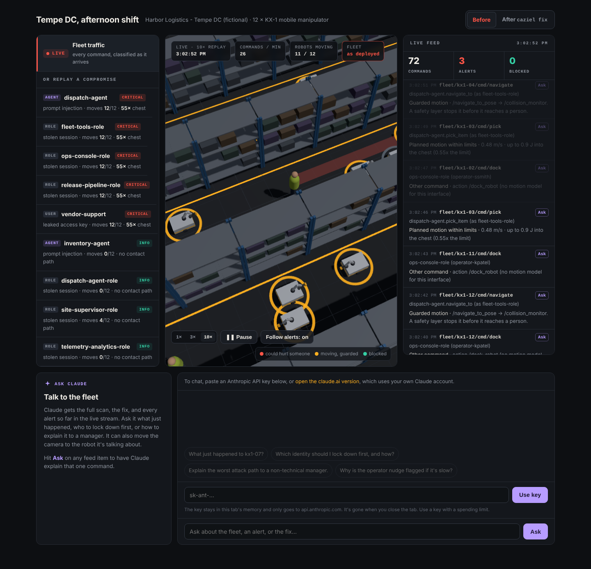

# Caziel

**If this AWS identity or AI agent gets compromised, which robots can it move, and how hard can they hit someone?**

[](https://github.com/CasimirTerr/CAZIEL/actions/workflows/ci.yml)


**[Live demo →](https://casimirterr.github.io/CAZIEL/)**



Caziel is a security tool for robot fleets that are run from the cloud. It takes the files you already have (IAM policies, your AI agent configs, the robot's edge bridge config, a ROS 2 graph snapshot, and the URDF) and follows every path from a cloud identity to a motor. For each path it works out which safety layers the command goes through or skips, how fast the robot can end up moving, and how much energy that puts into a person compared with ISO/TS 15066 pain thresholds.

It does three things with that:

- **`caziel scan`**: what *could* happen. Every identity and AI agent, every robot they can reach, and the worst hit.
- **`caziel watch`**: what *is* happening. It reads AWS IoT Core command traffic as it arrives and flags the commands that use those dangerous paths, with who sent them and how hard they could hit.
- **`caziel fix`**: a hardened copy of the fleet, scanned again to prove the fix works.

The name comes from mine.

## Why I built this

Robots are getting their instructions from cloud AI now. A warehouse fleet might take jobs from a Bedrock AgentCore agent that reads customer tickets and camera snapshots, publishes to AWS IoT Core, and has a Greengrass component on each robot that turns MQTT messages into ROS 2 commands.

Every one of those layers has security tooling, but each tool stops at the edge of its own layer:

- IAM analyzers tell you a role can `iot:Publish` to `fleet/*`. They don't know that one of those topics drives the wheels.
- ROS 2 tools show you the node graph. They don't know who in the cloud can reach it.
- Safety engineers validate the robot cell with a force gauge. They assume the commands come from the planner, not from a leaked access key.

The dangerous paths cross all three. The example fleet in this repo has a mistake that I think is easy to make in real life. During a pilot, someone added a "nudge" mapping so operators could push a stuck robot off a pallet edge. It publishes straight to `/cmd_vel`, which is the collision monitor's *output*. Every path from the cloud to that topic skips the one node that's supposed to stop the robot before it hits someone. Nothing in the IAM policy, the ROS graph or the bridge config looks wrong on its own. You only see it when you follow the whole chain.

## What it finds in the example fleet

```
$ caziel scan examples/harbor-fleet

Caziel 1.0.0  Harbor Logistics - Tempe DC  ·  12 robots (KX-1 mobile manipulator)

  CRITICAL 12   HIGH 10   MEDIUM 5

Who can move your robots

  ACTOR                               ROBOTS  BASE m/s  ARM m/s   WORST HIT               SEVERITY
  agent:dispatch-agent                 12/12      2.00     4.79   arm → chest 55x         CRITICAL
  principal:fleet-tools-role           12/12      2.00     4.79   arm → chest 55x         CRITICAL
  principal:ops-console-role           12/12      2.00     4.79   arm → chest 55x         CRITICAL
  principal:release-pipeline-role      12/12      2.00     4.79   arm → chest 55x         CRITICAL
  principal:vendor-support             12/12      2.00     4.79   arm → chest 55x         CRITICAL
  agent:inventory-agent                 0/12      0.00     0.00   no contact path         INFO
  principal:dispatch-agent-role         0/12      0.00     0.00   no contact path         INFO
  principal:site-supervisor-role        4/12      0.00     0.00   no contact path         INFO
  principal:telemetry-analytics-role    0/12      0.00     0.00   no contact path         INFO
```

The worst chain, step by step:

```
1. ENTRY    Indirect prompt injection via work-order tickets / dock camera snapshots
2. AGENT    dispatch-agent.tune_speed
3. IOT      iot:Publish fleet/kx1-01/cmd/param: rewrites parameters on /move_group
4. AGENT    dispatch-agent.pick_item
5. IOT      iot:Publish fleet/kx1-01/cmd/pick
6. EDGE     kx1-edge-bridge on kx1-01 turns it into /move_action
7. ROS      /move_action → /move_group (caps and zones already lifted on /move_group)
8. PHYSICAL Arm reaches a person at 4.79 m/s: 86.9 J into the chest, 55x the 1.57 J limit
```

Some other things it caught:

- **The ops console can hijack the agent's tools.** `ops-console-role` has `lambda:UpdateFunctionCode` on `fleet-*` "for hotfixes". All the agent's tools share `fleet-tools-role`, which can publish anywhere under `fleet/*`. So rewriting one harmless tool gives the console the raw arm and lifecycle topics too.
- **The vendor's support key can run code on every robot.** `iot:*` on `*` includes `iot:CreateJob`, and the robots' job agent runs shell commands.
- **The scoped role is correctly called safe.** `site-supervisor-role` can move 4 robots, but only through Nav2, where the collision monitor sits on the path. It gets no findings. This is the case that tells you the tool isn't just flagging everything.

## Watching it live

`caziel watch` takes AWS IoT Core traffic as JSON lines, the shape an IoT rule produces with `SELECT topic() AS topic, principal() AS principal, timestamp() AS ts, * AS payload FROM 'fleet/+/cmd/#'`. It classifies each command with the same model the scanner uses.

It works out who really sent the command. IoT reports an IAM caller as `<role id>:<session name>`. Caziel maps the role ID back to `iam.json`, and a Lambda session name back to the agent tool behind it. So `AROA...:fleet-nudge` shows up as `dispatch-agent.nudge (as fleet-tools-role)`, not just "the tools role".

It also keeps state per robot. If a parameter write lifts MoveIt's speed limit on kx1-07, the next pick on kx1-07 is judged with the limit gone.

```
$ caziel watch examples/harbor-fleet examples/harbor-fleet/traffic/shift.jsonl --min-severity high

HIGH     fleet/kx1-07/cmd/param      dispatch-agent.tune_speed (as fleet-tools-role)  Safety or speed limit rewritten: /move_group default_velocity_scaling_factor = 1.0
CRITICAL fleet/kx1-07/cmd/pick       dispatch-agent.pick_item (as fleet-tools-role)   Motion with speed limits lifted: 4.79 m/s · up to 86.9 J into the chest (55x the limit)
CRITICAL fleet/kx1-07/cmd/velocity   dispatch-agent.nudge (as fleet-tools-role)       Velocity command skips the collision monitor: 1.90 m/s · up to 82.3 J into the thigh and knee (43x the limit)
HIGH     fleet/kx1-10/cmd/lifecycle  vendor-support                                   Safety node shut down from the cloud: deactivate on /collision_monitor
CRITICAL fleet/kx1-10/cmd/arm        vendor-support                                   Raw arm trajectory, no MoveIt checks: 4.79 m/s · up to 86.9 J into the chest (55x the limit)
caziel watch: 161 events (6 critical, 2 high, 14 medium, 139 info)
```

`shift.jsonl` is six minutes of a normal afternoon with three incidents mixed in: a prompt-injected work order, a session on the vendor's old access key, and a principal that isn't in `iam.json`. Run the same file against the hardened fleet and every one of those commands comes back as *Denied by IAM*, *Held for human approval*, or *Dropped by the edge bridge*.

To watch a real fleet, point it at the log group your IoT rule writes to:

```bash
aws logs tail /iot/fleet-commands --follow --format short | cut -d' ' -f3- | caziel watch my-fleet --fail-on critical
```

## The website

The [demo site](https://casimirterr.github.io/CAZIEL/) has three parts:

- **Live view.** The 3D warehouse plays the recorded shift. Robots move to their goals, and every command shows up in the feed with Caziel's verdict. When something critical happens, the camera flies to the robot. Flip to *After* to watch the same shift against the fixed fleet.
- **Replay.** Pick any identity or agent and watch its worst attack chain step by step, ending at the motors.
- **Ask Claude.** A chat panel that gets the scan, the fix and every alert so far. Hit *Ask* on any feed item to have it explained. It can also move the camera to the robot it's talking about. On GitHub Pages it uses your own Anthropic API key, which stays in the tab and only goes to `api.anthropic.com`. The [claude.ai copy](https://claude.ai/artifact/MisML9kU3DMpbng3U9kY3q) runs it on your Claude account instead.

The page doesn't compute anything itself. Everything it shows comes from `docs/data/`, which is the engine's own output. The browser test checks that every number and every feed line matches it.

## The fix

```
$ caziel fix examples/harbor-fleet -o examples/harbor-fleet-hardened

Hardened fleet written to examples/harbor-fleet-hardened (15 changes)

| Actor                            | Robots it can hurt | Worst hit                          | Severity                   |
|----------------------------------|--------------------|------------------------------------|----------------------------|
| agent:dispatch-agent             | 12 → 0             | arm → chest 55x → no contact path  | critical → medium          |
| principal:fleet-tools-role       | 12 → 0             | arm → chest 55x → no contact path  | critical → medium          |
| principal:ops-console-role       | 12 → 0             | arm → chest 55x → no contact path  | critical → medium          |
| principal:release-pipeline-role  | 12 → 12            | arm → chest 55x → arm → chest 55x  | critical → info (accepted) |
| principal:vendor-support         | 12 → 0             | arm → chest 55x → no contact path  | critical → medium          |
```

The fix tries to keep the workflow working. It only removes an interface when there's no safe version of it.

- **Nudge:** retargeted from `/cmd_vel` to `/cmd_vel_smoothed` (the collision monitor's input), plus `requires_approval`. It still works, but it can't drive into a person.
- **Raw arm trajectories:** removed. Taught motions should go through MoveIt.
- **Wildcard parameter writes:** removed. Use Nav2 speed filter zones instead.
- **Lifecycle:** limited to non-safety nodes, so operators can still restart a hung planner.
- **Speed caps:** set from the physics. A 116 kg base has to stay under 0.29 m/s to stay inside the thigh limit, so shared-zone speed is capped at 0.25.
- **SROS2:** permissions for the bridge enclave, with explicit DENY on the collision monitor's lifecycle and parameter services.
- **IAM:** explicit-deny guardrails, a `NotResource` scope on the tool role, and an Organizations SCP version of the same rules.
- **Release pipeline:** it has to deploy code, so Caziel doesn't silently drop that finding. It marks it as *accepted* with a written condition (signed components, OIDC trust pinned to `main`) and lists it under "still to do by hand".

Everything is in [`examples/harbor-fleet-hardened/caziel-fix/CHANGES.md`](examples/harbor-fleet-hardened/caziel-fix/CHANGES.md).

## How it works

```
 cloud/iam.json        cloud/agents.yaml         fleet.yaml              bridge.yaml            graph.json + params.yaml        robot.urdf
 ──────────────        ─────────────────         ──────────            ─────────────           ────────────────────────        ──────────
  IAM principals  ──▶  AI agents + tools   ──▶   AWS IoT Core     ──▶   edge bridge      ──▶   ROS 2 velocity dataflow   ──▶  mass, reach,
  (leaked creds)       (prompt injection)        Publish / Jobs /       MQTT → ROS            which safety nodes are         tip speed
                                                 Greengrass deploy      topic/action/param    on the path or skipped         ──▶ ISO/TS 15066
```

1. **Actors.** Every IAM principal is treated as if its credentials leaked. Every AI agent is treated as if it got prompt-injected through its untrusted inputs.
2. **Cloud reach.** An offline IAM evaluator checks `iot:Publish` on every bridge topic for every robot, plus `iot:CreateJob` (when the job handler runs commands), `greengrass:CreateDeployment`, agent invocation, and `lambda:UpdateFunctionCode` on agent tools. Escalations follow on from each other: rewriting a tool's Lambda gives you that tool role's whole reach.
3. **Edge bridge.** The bridge's mapping table turns reachable MQTT topics into ROS 2 topics, actions, parameter writes and lifecycle calls. `requires_approval` marks a mapping as gated by a human.
4. **ROS 2 graph.** For velocity, Caziel walks the Twist dataflow from each entry topic to the base controller. It records which nodes are on the way (velocity smoother, collision monitor) and which safety nodes get skipped. Parameter access can lift speed caps or switch off collision zones. Lifecycle access can shut safety nodes down.
5. **Motors.** From the URDF: total mass, the arm's moving mass and reach, and a worst-case tool-tip speed bound. That's each joint at its velocity limit with the rest of the arm stretched out. MoveIt's velocity scaling applies on planned paths but not on raw `FollowJointTrajectory` goals.
6. **Person.** Energy is transferred at the fastest speed the robot can reach a person, using the ISO/TS 15066 two-body model:

   - `E_max = F² / 2k`
   - `E = ½ μ v²`
   - `μ = (1/m_H + 1/m_R)⁻¹`
   - `v_safe = F / √(μk)`

   A route counts as reaching a person only if no active collision monitor is on it and no human approval gates it.

The checks are listed in [CHECKS.md](CHECKS.md). They're mapped to MITRE ATT&CK for ICS, ATT&CK Enterprise, and MITRE ATLAS (`AML.T0051.001` for indirect prompt injection).

## Running it

```bash
pip install git+https://github.com/CasimirTerr/CAZIEL

caziel scan examples/harbor-fleet                       # terminal report
caziel scan examples/harbor-fleet -f md -o report.md    # Markdown (good for PR comments)
caziel scan examples/harbor-fleet -f json --fail-on critical   # exit 2 if anything critical is open
caziel fix examples/harbor-fleet -o hardened/           # hardened copy + CHANGES.md + SROS2 + SCP
caziel robot examples/harbor-fleet/robots/kx1           # physical envelope and velocity paths
caziel checks                                           # list checks
caziel watch examples/harbor-fleet examples/harbor-fleet/traffic/shift.jsonl   # live classifier
```

On a robot, with ROS 2 sourced, `caziel snapshot` captures the live graph. It's read-only: `ros2 node list`, `ros2 node info`, `ros2 param dump`.

```bash
caziel snapshot -o robots/kx1/graph.json --params robots/kx1/params.yaml
```

The input format is documented in [docs/FORMAT.md](docs/FORMAT.md). The only dependency is PyYAML. It never calls AWS or touches a robot except for `snapshot`, so it's safe to run in CI on exported configs.

## Testing

- **Python:** 94 pytest tests, about 98% coverage, CI on Python 3.9, 3.11 and 3.13, plus `ruff` and `mypy`.
- **CI checks the example itself:** the vulnerable example has to fail `--fail-on critical`, and the hardened one has to pass.
- **Generated files can't drift:** `CHECKS.md`, the hardened example, and the site data are rebuilt in CI and compared, so they can't fall out of sync with the code.
- **Browser test:** `tests/web/check_web.js` runs the site in headless Chromium. It checks:
  - the live feed against `caziel watch`'s output, line by line
  - the same shift before and after the fix
  - both replays
  - the Claude chat, including a tool call, against a mocked API
  - no console errors

## Limitations

- **The physics is an estimate.** It's for ranking security risk, not a functional-safety assessment. The tip-speed bound is deliberately conservative, real contacts are not perfectly inelastic, and a certified safety PLC or drive-level speed limit is not modelled. Caziel tells you to add one.
- **Body-region values are the commonly cited ISO/TS 15066:2016 Annex A numbers** (now informative Annex M of ISO 10218-2:2025). Check them against your copy of the standard. They can be overridden per fleet in `fleet.yaml`.
- **IAM evaluation covers identity policies only.** Conditions are treated conservatively (an Allow with a condition counts, a Deny with a condition doesn't). Resource policies, permission boundaries, SCPs, and AWS IoT Core's own IoT policies are not evaluated yet.
- **Base and arm are analyzed separately.** A moving base adds to arm tip speed in reality.
- **Only the dataflow is analyzed, not the code.** A node that ignores its parameters, or a bridge with a bug, isn't caught.
- **`watch` trusts the log.** It sees commands that reached IoT Core and were logged by your rule. It isn't an inline block, so pair it with the IAM and bridge fixes, not instead of them.

## Project layout

```
caziel/            the engine (iam, urdf, ros, edge, cloud, analysis, physics, live, policy, report, cli)
examples/           harbor-fleet (vulnerable) and harbor-fleet-hardened (generated by caziel fix)
docs/               the website (GitHub Pages), its data, and FORMAT.md
scripts/            generators for CHECKS.md, the sample traffic, and the site data
tests/              pytest suite and the browser check
```

Harbor Logistics, the KX-1 robot, and every account ID and ARN in this repo are made up.

## License

MIT. Three.js is vendored under its own MIT license in `docs/vendor/`.
